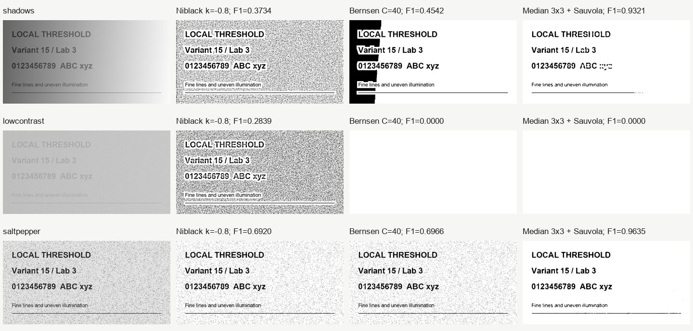
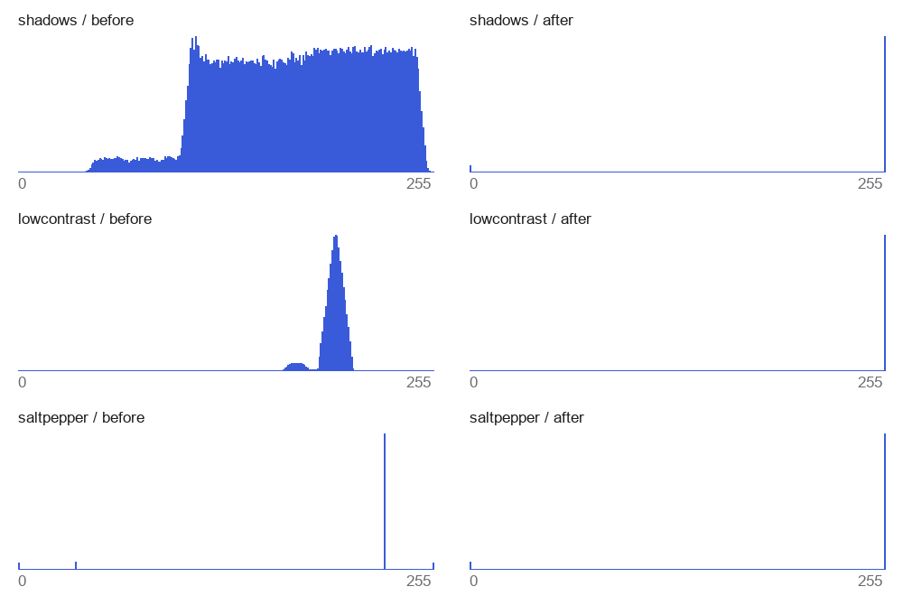

# ОТЧЁТ ПО ЛАБОРАТОРНОЙ РАБОТЕ №3

**Тема:** «Основы обработки цифровых изображений»

**Выполнил:** Мищук Егор

**Группа:** 11

**Вариант:** №15

**Методы обработки:** локальная и адаптивная пороговая обработка, нелинейные фильтры на порядковых статистиках

2026

## 1. Цель работы

Изучить принципы локальной и адаптивной пороговой обработки цифровых изображений, освоить нелинейные фильтры, основанные на порядковых статистиках, и разработать интерактивное веб-приложение для сравнения результатов их применения. Рассмотреть влияние размера окна, параметров алгоритма, обработки границ и предварительного подавления шума на качество результата, а также реализовать ускорение вычислений с помощью интегральных изображений и обработки в нескольких потоках.

## 2. Поставленная задача

В соответствии с вариантом №15 необходимо разработать веб-приложение, объединяющее два метода локальной пороговой обработки, адаптивную пороговую обработку и нелинейные фильтры на порядковых статистиках. В приложении требуется:

- реализовать собственные алгоритмы Ниблэка и Бернсена для локальной пороговой обработки;
- реализовать адаптивную пороговую обработку методом Сауволы и дополнительным методом Брэдли для сравнения;
- реализовать медианный, минимальный и максимальный фильтры без использования готовых библиотечных функций обработки изображений;
- обеспечить прямую работу с пиксельными буферами и отделить математические алгоритмы от пользовательского интерфейса;
- использовать интегральные изображения для вычисления локальных среднего и дисперсии;
- реализовать две стратегии обработки границ: Clamp и Reflect;
- создать интерфейс загрузки изображений, выбора метода и настройки его параметров;
- обеспечить сравнение изображений и гистограмм до и после обработки, отображение прогресса и сохранение результата;
- выполнять обработку в Web Workers с возможностью выбора числа потоков и отмены вычислений;
- подготовить базу подходящих тестовых изображений и автоматические проверки корректности алгоритмов.

В качестве адаптивного метода выбран Саувола. Алгоритм из лекции не был предоставлен, поэтому этот выбор согласован отдельно и не означает воспроизведения конкретной лекционной реализации. Дополнительно выполнены требования к пиксельному доступу, оптимизации и архитектуре из дополнения для группы 10А.

## 3. Инструментарий

| Компонент | Используемое средство |
| --- | --- |
| Язык программирования | JavaScript, ES-модули без сторонних библиотек обработки изображений |
| Разметка | HTML5 |
| Стилизация | CSS3, адаптивная вёрстка, светлая и тёмная темы |
| Работа с изображениями | Canvas API для декодирования и вывода, типизированные массивы для вычислений |
| Архитектура | Интерфейс, слой доступа к пикселям, математические алгоритмы и управление потоками |
| Параллельные вычисления | Module Web Workers, передача пиксельных буферов |
| Тестирование | Встроенный модуль Node.js `node:test`, Node.js 20+ |
| Среда выполнения | Современный браузер; проверка интерфейса в Google Chrome |
| Подготовка тестовых изображений | Python и Pillow; используются только во вспомогательных скриптах |
| Контроль версий | Git, общий репозиторий `pkguni`, подпапка `lab3` |

## 4. Теоретическая часть и алгоритмы

### 4.1. Представление изображения и переход к яркости

Исходное изображение декодируется браузером и одним блоком считывается из Canvas. Затем компоненты RGB переводятся в яркость по формуле Y = 0,299R + 0,587G + 0,114B. При наличии прозрачности цвет предварительно накладывается на белый фон. Значения яркости округляются до целых чисел от 0 до 255 и хранятся в типизированном массиве `Uint8Array`.

Все последующие преобразования выполняются непосредственно над этим массивом. Canvas используется для загрузки и отображения результата, но не для фильтрации. Обработка производится в пространстве яркости; независимая фильтрация цветовых каналов не реализуется.

### 4.2. Локальная пороговая обработка

Для каждого пикселя рассматривается квадратное окно со стороной 2r + 1, где r — выбранный радиус. Яркость I сравнивается с порогом T: если I > T, выходной пиксель становится белым (255), иначе — чёрным (0).

В методе Ниблэка порог вычисляется по формуле T = m + kσ, где m — среднее значение яркости в окне, σ — стандартное отклонение, k — настраиваемый коэффициент. Отрицательное значение k сдвигает порог вниз. Метод позволяет выделять слабые штрихи, но на текстурном фоне может создавать ложные чёрные пиксели.

В методе Бернсена порог равен T = (Imin + Imax)/2, где Imin и Imax — минимальная и максимальная яркости в окне. Дополнительно проверяется локальный контраст Imax − Imin. Если он меньше заданного значения C, окно считается малоконтрастным: для обрабатываемого пикселя устанавливается белый цвет при T ≥ 128 и чёрный в противном случае. Правило обработки малоконтрастных окон явно зафиксировано, поскольку существуют разные варианты этого метода.

### 4.3. Адаптивная пороговая обработка

В методе Сауволы применяется порог T = m[1 + k(σ/R − 1)], где R — параметр динамического диапазона стандартного отклонения; в экспериментах R = 128. При небольшой локальной дисперсии порог понижается, что помогает очищать светлый фон документа. Слишком большое k может приводить к исчезновению слабоконтрастного текста.

В качестве дополнительного метода реализован Брэдли: T = m(1 − t/100), где t — процентный отступ от локального среднего. Оба метода используют характеристики окрестности пикселя, а не единый порог для всего изображения. Выделение Сауволы и Брэдли в отдельную группу интерфейса соответствует постановке работы; математически они также являются локальными пороговыми методами.

### 4.4. Нелинейные фильтры на порядковых статистиках

Пиксели окна мысленно упорядочиваются по возрастанию яркости. Минимальный фильтр выбирает первый элемент, медианный — средний, максимальный — последний. Медиана подавляет одиночные светлые и тёмные импульсы, минимум расширяет тёмные детали, а максимум — светлые. Большое окно может удалять тонкие линии и мелкие объекты.

В программе сортировка каждого окна заменена скользящей гистограммой из 256 значений. При сдвиге окна удаляются значения уходящего столбца и добавляются значения нового. Затем по накопленной частоте находится нужный ранг. Та же гистограмма применяется для поиска минимума и максимума в методе Бернсена. Начальная гистограмма строится заново для каждой строки. Оценка сложности обработки составляет O((K + 256)WH), где K — сторона окна, W и H — размеры изображения.

Дополнительно предусмотрена предварительная медианная фильтрация с фиксированным окном 3×3 перед выбранным алгоритмом. Она позволяет подавить импульсный шум до бинаризации, не применяя большое окно, способное разрушить тонкие штрихи.

### 4.5. Интегральные изображения

Для расчёта локальных характеристик строятся две интегральные таблицы: S — суммы интенсивностей и Q — суммы их квадратов. Сумма любого прямоугольного окна получается четырьмя обращениями к соответствующей таблице. Для окна из n пикселей среднее равно m = Sокна/n, а дисперсия — σ² = Qокна/n − m².

Таблицы хранятся в `Float64Array`, чтобы избежать переполнения 32-битных сумм квадратов. Небольшое отрицательное значение дисперсии, возникающее из-за погрешности округления, ограничивается нулём перед извлечением квадратного корня. После построения таблиц локальные характеристики для Ниблэка, Сауволы и Брэдли вычисляются за O(1) на пиксель.

### 4.6. Обработка границ и разделение на потоки

В режиме Clamp координата за пределами изображения заменяется ближайшей допустимой координатой, то есть крайний пиксель повторяется. В режиме Reflect изображение зеркально продолжается без повторения граничного пикселя. Это позволяет обрабатывать края теми же алгоритмами, что и внутреннюю область, не обрезая их и не заполняя чёрным.

Для параллельной обработки изображение делится на горизонтальные полосы. Каждая полоса получает дополнительные строки сверху и снизу в пределах радиуса окна. После обработки служебные строки удаляются, а центральные части объединяются в итоговый буфер. Благодаря перекрытию результат не зависит от количества полос и не содержит швов между ними. На небольших изображениях дополнительные затраты на запуск потоков и передачу данных могут превышать выигрыш от параллельных вычислений.

## 5. Архитектура программы

Для разделения вычислений и пользовательского интерфейса реализована слоистая архитектура.

**Слой доступа к пикселям** — `js/model/buffer.js`. Содержит обёртку `GrayBuffer`, преобразование RGBA в яркость и стратегии Clamp/Reflect. Изолирует алгоритмы от особенностей хранения пикселей и обращения к координатам за пределами изображения.

**Математический слой** — `js/model/processing.js`. Содержит чистые функции построения интегральных изображений и гистограмм, локальной и адаптивной бинаризации и порядковой фильтрации. Функции принимают пиксельный буфер и параметры и возвращают новый буфер, ничего не зная о DOM.

**Разделение и сборка изображения** — `js/model/tiles.js`. Подготавливает полосы с перекрытием и объединяет их результаты без служебных строк.

**Управление вычислениями** — `js/services/processor.js` и `js/worker/processWorker.js`. Организует обработку в одном, двух или четырёх Web Workers, передачу буферов, сообщения о прогрессе, обработку ошибок и отмену. Каждый запуск владеет своими потоками, поэтому завершение отменённого запуска не останавливает следующий.

**Пользовательский интерфейс** — `index.html`, `style.css` и `js/main.js`. Отвечает за загрузку файлов, параметры, команды запуска и отмены, отрисовку изображений и гистограмм и экспорт PNG. Исходное изображение сохраняется неизменным; каждый запуск использует его яркостный буфер.

## 6. Разработка пользовательского интерфейса

Интерфейс состоит из панели загрузки, панели параметров и двух областей сравнения: «До обработки» и «После обработки». Изображение можно выбрать с компьютера, перетащить в окно или открыть из встроенной тестовой базы. Отображаются имя файла и размеры изображения.

На панели параметров доступны выбор метода, ползунок радиуса окна, числовые поля коэффициентов, стратегия обработки границ и число рабочих потоков. Поля, не относящиеся к выбранному методу, скрываются и не участвуют в проверке параметров. Предварительная медианная фильтрация 3×3 включается отдельным флажком. Изменения применяются после нажатия кнопки «Обработать».

Во время вычислений отображается прогресс и доступна кнопка остановки. После завершения выводятся название метода, размер окна, режим границ, число потоков, время выполнения и доля чёрных пикселей. Результат можно сохранить в формате PNG. Под изображениями отображаются гистограммы яркости, а формулы и пояснения к методам вынесены в раскрывающийся справочный блок.

Оформление соответствует первым лабораторным работам: нейтральный фон, панели со скруглёнными границами, синий акцент и автоматическое переключение светлой и тёмной темы. На узком экране элементы размещаются в одну колонку. Для ограничения расхода памяти допускается загрузка файлов до 40 МиБ и изображений до 8 мегапикселей без скрытого уменьшения размера.

## 7. Тестирование

### 7.1. Автоматическая проверка алгоритмов

Для проверки корректности созданы автоматические тесты, запускаемые командой `npm run test:lab3` из корня репозитория или `npm test` из папки `lab3`. Используется встроенный модуль Node.js `node:test` без сторонних тестовых библиотек. Проверяются, в частности:

- совпадение всех методов с независимой реализацией, собирающей каждое окно и сортирующей его значения;
- стратегии Clamp и Reflect, включая координаты далеко за границей и изображение из одного пикселя;
- окна, размеры которых превышают размеры изображения;
- вычисление интегральных сумм и сумм квадратов без переполнения 32-битного диапазона;
- преобразование RGBA в яркость и наложение прозрачности на белый фон;
- подавление одиночного импульса медианным фильтром и выбор крайних рангов;
- построение гистограммы и отклонение некорректных буферов и параметров;
- совпадение обработки полос с перекрытием и обработки целого изображения;
- отмена предыдущего запуска без остановки потоков следующего.

Всего реализовано 28 автоматических тестов: 27 для математического слоя и один для управления повторным запуском с использованием настоящих потоков Node.js. При проверке все тесты прошли успешно. Отдельно в браузере проверены методы обработки, работа в двух и четырёх потоках, предварительная медиана, экспорт PNG, отмена, загрузка ошибочного файла и мобильная тёмная тема.

### 7.2. Подготовка тестовой базы

Подготовлены четыре синтетических изображения размером 720×360: текст с неоднородным освещением, малоконтрастный текст на текстурном фоне, текст с импульсным шумом «соль и перец» и светлые и тёмные детали разных размеров. Для первых трёх примеров сохранена эталонная бинарная маска текста. Генерация воспроизводима: используется фиксированное начальное состояние генератора случайных чисел seed = 15.

Вспомогательный скрипт `samples/generate.py` создаёт исходные PNG, а `samples/analyze.py` выполняет измерения через математические модули JavaScript и формирует иллюстрации. Pillow используется только в этих скриптах; приложению в браузере он не требуется.

### 7.3. Сравнение качества обработки

Использованы синтетические изображения 720×360 с известной бинарной маской текста. В первых трёх примерах положение штрихов одинаково; меняется фон и шум. Параметры: окно 15×15, Reflect, k Ниблэка = −0,2, k Сауволы = 0,34, R = 128, t Брэдли = 15. Предварительная медиана — 3×3.

Качество измерено F1 по чёрному переднему плану: F1 = 2TP/(2TP + FP + FN). Большое число белых фоновых пикселей не завышает эту оценку. Синтетическая база показывает конкретные случаи и не доказывает универсального превосходства метода на фотографиях и сканах.

| Изображение | Ниблэк | Бернсен C=30 | Бернсен C=40 | Саувола | Брэдли | Медиана + Саувола |
| --- | ---: | ---: | ---: | ---: | ---: | ---: |
| Неравномерное освещение | 0,2246 | 0,4542 | 0,4542 | 0,9617 | 1,0000 | 0,9321 |
| Низкий контраст | 0,2087 | 1,0000 | 0,0000 | 0,0000 | 0,0000 | 0,0000 |
| Соль и перец | 0,6962 | 0,6961 | 0,6966 | 0,6966 | 0,6966 | 0,9635 |

Исходные измерения, включая дополнительные параметры, время и гистограммы: [measurements.json](samples/measurements.json). Воспроизведение: `python lab3/samples/analyze.py` из корня репозитория с Pillow и Node.js. Измеряется математическая обработка в одном процессе Node.js, включая предварительную медиану; время интерфейса включает ещё запуск Web Workers и вывод Canvas и напрямую с этим временем не сравнивается.

- **Освещение:** локальные методы Ниблэка и Бернсена оставляют значительные ошибки на фоне. Адаптивные Саувола и Брэдли дают качественный текст. Добавление медианы здесь немного ухудшает F1: она повреждает тонкие штрихи без необходимости подавления шума.
- **Низкий контраст:** Бернсен при C = 30 сохраняет штрихи лучше Ниблэка. При C = 40 те же окна объявляются малоконтрастными и штрихи пропадают; Ниблэк тогда сохраняет часть текста и формально выигрывает у Бернсена. Это демонстрация чувствительности параметра, а не преимущество Ниблэка при оптимальной настройке обоих методов. Для Сауволы и Брэдли выбранные параметры слишком агрессивны — следует уменьшить k или t.
- **Импульсный шум:** без предварительной обработки бинаризация сохраняет чёрные импульсы. Медиана 3×3 перед Сауволой поднимает F1 с 0,6966 до 0,9635. Большие окна могут уничтожать тонкие линии, поэтому радиус медианы предварительного этапа равен 1.
- **Ранги:** на `details.png` минимум удаляет небольшие светлые детали, одновременно расширяя тёмные; максимум действует противоположно. Медиана уничтожает мелкие детали обоих знаков. Эти эффекты являются свойствами фильтров, а не ошибками.

Каждая гистограмма нормирована на свой максимум. До обработки диапазон отражает фон, текст и шум; после бинаризации остаются два пика 0 и 255. Наличие двух пиков само по себе не означает хорошее качество: при низком контрасте результат может оказаться полностью белым, что видно и на гистограмме, и по F1.

## 8. Результат работы

В результате разработано интерактивное веб-приложение для исследования локальной и адаптивной пороговой обработки и нелинейных фильтров на порядковых статистиках. Реализованы собственные математические алгоритмы, настройка параметров, две стратегии обработки границ, предварительная медианная фильтрация, интегральные изображения, многопоточная обработка, тестовая база, сравнение гистограмм и сохранение результата в PNG. Корректность вычислений и обработки повторных запусков проверена автоматическими тестами.

Исходный код, тесты, изображения и документация находятся в подпапке `lab3` общего репозитория `pkguni`. Приложение запускается через статический HTTP-сервер и не требует сборки или серверной обработки изображений. Все вычисления выполняются в браузере; выбранные пользователем файлы не отправляются на сервер.

Для локального запуска из корня репозитория можно выполнить `python -m http.server 8000` и открыть <http://localhost:8000/lab3/>. Инструкция по размещению на Railway приведена в [README](README.md). Публичное размещение не выполнялось в рамках разработки; для выполнения требования сдачи веб-приложения в общем доступе его необходимо разместить на сервере.

## 9. Вывод

В ходе лабораторной работы были изучены методы локальной и адаптивной пороговой обработки изображений и нелинейные фильтры, основанные на порядковых статистиках. Реализованы локальные методы Ниблэка и Бернсена, адаптивные методы Сауволы и Брэдли, а также медианный, минимальный и максимальный фильтры. Создано интерактивное веб-приложение, позволяющее загружать изображения, выбирать алгоритм, настраивать размер окна и параметры обработки, сравнивать исходное изображение с результатом и сохранять результат в формате PNG. Все алгоритмы написаны вручную и работают непосредственно с пиксельными буферами. Для ускорения расчёта локальных среднего и дисперсии использованы интегральные изображения, для порядковых фильтров — скользящая гистограмма, а для корректной обработки границ реализованы стратегии Clamp и Reflect. Выполнение вычислений в Web Workers позволило сохранить отзывчивость интерфейса и организовать обработку в нескольких потоках. Сравнение на тестовых изображениях показало, что качество результата зависит от характера искажений и выбранных параметров: адаптивные методы эффективны при неоднородном освещении, а предварительная медианная фильтрация улучшает бинаризацию изображений с импульсным шумом. Разделение приложения на интерфейс, слой доступа к пикселям и математические алгоритмы позволило независимо проверить вычисления автоматическими тестами. Таким образом, реализована обработка изображений по варианту 15 и исследованы особенности применения выбранных методов; для выполнения требования публичной сдачи приложение необходимо разместить на сервере.
